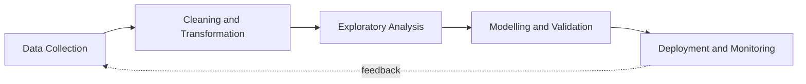

**M.Sc. Big Data Analytics, St. Xavier's College, Mumbai**

---

## About

I am a postgraduate student pursuing an M.Sc. in Big Data Analytics at St. Xavier's College, Mumbai, with an academic background in Information Technology. My work spans the full data lifecycle: collecting and processing data, building analytical and predictive models, and delivering the results as practical software.

**Areas of focus**

- Data analysis, statistical modelling and predictive analytics
- Streaming and large-scale data processing
- Forecasting, simulation and optimization
- Full-stack application development

---

## Technical Skills

| Category | Tools and Technologies |
| :--- | :--- |
| Languages | Python, Java, C++, TypeScript, JavaScript, SQL |
| Databases | MySQL, MongoDB |
| Data Science and Analytics | Pandas, NumPy, Scikit-learn, TensorFlow |
| Web Development | Next.js, Node.js, Tailwind CSS |
| Tools | Git, GitHub, Visual Studio Code |

  

---

## Featured Projects

<table>
  <tr>
    <td width="50%" valign="top">
      <h3>BehaviorFlow</h3>
      <b>Streaming Analytics and Conversion Anomaly Investigation</b>
      
A research-oriented prototype for detecting conversion anomalies in streaming event data and investigating them at the segment level, designed to operate under imperfect event data.

      
<i>Focus areas: streaming analytics, anomaly detection, big data</i>

    </td>
    <td width="50%" valign="top">
      <h3>SupplyChainIQ</h3>
      <b>Predictive Analytics and Supply Chain Optimization</b>
      
A data-driven system that forecasts product demand, simulates supply disruptions and optimizes inventory replenishment.

      
<i>Focus areas: demand forecasting, simulation, optimization</i>

    </td>
  </tr>
  <tr>
    <td width="50%" valign="top">
      <h3>Zero2Hero</h3>
      <b>Waste Management System</b>
      
A web-based waste management platform built with Next.js, TypeScript and Tailwind CSS.

      
<i>Stack: Next.js, TypeScript, Tailwind CSS</i>

      
<a href="https://github.com/devansh-singh-7/zero2hero-Waste-Management-System">View repository</a>

    </td>
    <td width="50%" valign="top">
      <h3>FixItNow</h3>
      <b>AI-Powered Smart Maintenance System</b>
      
A maintenance management platform incorporating image-based issue classification, predictive failure analysis, technician assignment and payment management.

      
<i>Focus areas: image classification, predictive analysis, full-stack development</i>

    </td>
  </tr>
</table>

---

## Analytical Workflow

---

## GitHub Statistics

---

## Current Areas of Study

| Area | Focus |
| :--- | :--- |
| Statistics | Statistical modelling and hypothesis testing |
| Machine Learning | Predictive analytics and model evaluation |
| Big Data | Distributed and streaming data processing |
| Data Engineering | Data pipelines and cloud technologies |
| Algorithms | Problem solving and optimization |

---

## Contact

<!-- Add your own links below -->
<!--  -->
<!--  -->

  

Thank you for visiting.

